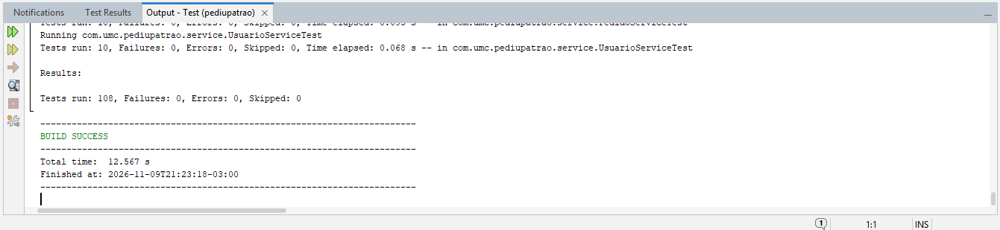
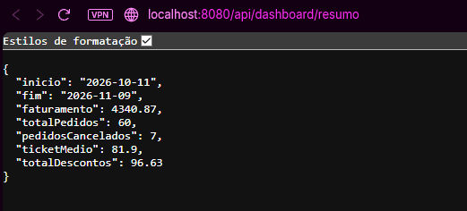
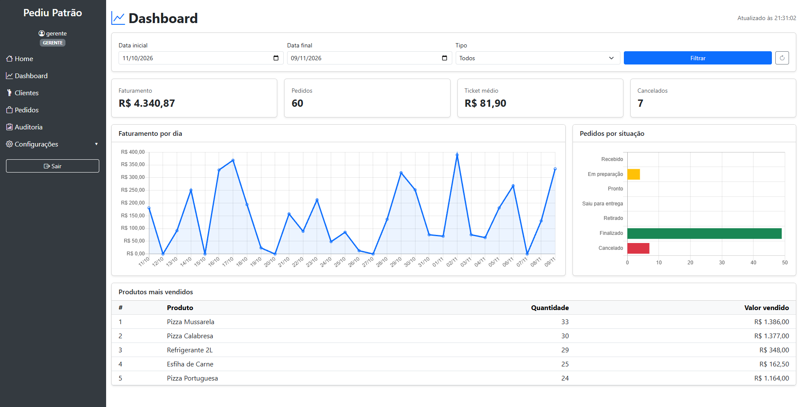

# Dashboard Administrativo - PediuPatrão

**Aluno:** Luiz Eduardo Dias  
**RGM:** 11231104074

Painel para o responsável pelo estabelecimento acompanhar vendas, situação dos pedidos e produtos mais vendidos. O painel consome uma API REST própria (`/api/dashboard`) que lê os pedidos gravados no MongoDB.

Acesso: menu **Dashboard** (perfis ADMIN e GERENTE) ou http://localhost:8080/dashboard.

## 1. Requisitos funcionais

| Código | Requisito | Como foi atendido |
|---|---|---|
| RF01 | Indicadores gerais de vendas | Cards de faturamento, total de pedidos, ticket médio e cancelados (`GET /api/dashboard/resumo`). |
| RF02 | Análise de vendas (gráficos) | Gráfico de linha com o faturamento de cada dia do período (`GET /api/dashboard/vendas-por-dia`). |
| RF03 | Situação dos pedidos | Gráfico de barras com a quantidade de pedidos em cada status (`GET /api/dashboard/pedidos-por-status`). |
| RF04 | Produtos mais vendidos | Ranking por quantidade vendida, com o valor vendido de cada produto (`GET /api/dashboard/produtos-mais-vendidos`). |
| RF05 | Filtros de consulta | Data inicial, data final e tipo (entrega ou retirada), aplicados a todos os indicadores. |
| RF06 | Integração com a API | A tela busca todos os dados na API via `fetch`; nenhum número é calculado no navegador. |
| RF07 | Atualização e tratamento de dados | Botão de atualizar, atualização automática a cada 60 s e horário da última atualização. Cancelados ficam fora do faturamento, dias sem venda aparecem com zero, erros da API aparecem na tela. |

## 2. Requisitos não funcionais

| Código | Requisito |
|---|---|
| RNF01 | **Segurança:** somente ADMIN e GERENTE acessam o painel e a API (regra por URL e `@PreAuthorize`). Sem login a API responde 401; com outro perfil, 403. |
| RNF02 | **Desempenho:** o banco é consultado apenas no período filtrado (`dataEntrada` entre início e fim). O período máximo é de 366 dias. |
| RNF03 | **Consistência:** os valores vêm do total já calculado no servidor em cada pedido; datas são agrupadas no fuso `America/Sao_Paulo`. |
| RNF04 | **Interoperabilidade:** API REST com respostas JSON, datas no formato ISO (`AAAA-MM-DD`) e erros em JSON padronizado. |
| RNF05 | **Usabilidade:** layout responsivo (Bootstrap) e gráficos com Chart.js servido pelo próprio sistema. |

## 3. Decisões de análise e projeto

- **Um endpoint por informação do painel** (resumo, vendas por dia, status, produtos). Cada bloco da tela tem sua fonte, e todos aceitam os mesmos filtros.
- **Agregação no servidor:** a tela só exibe. Regras como "cancelado não conta no faturamento" ficam em um único lugar (`DashboardService`).
- **Cancelados:** entram na contagem de pedidos e no gráfico de situação, mas não no faturamento, no ticket médio, nas vendas por dia nem no ranking.
- **Período padrão de 30 dias** quando nenhuma data é informada.
- **Dados de demonstração:** se o banco não tiver pedidos, o sistema cria 60 pedidos dos últimos 30 dias para o painel não abrir vazio (desligar com `app.seed.pedidos-demo=false`).

Fluxo: `dashboard.html → fetch /api/dashboard/* → DashboardController → DashboardService → PedidoRepository (MongoDB)`.

## 4. Documentação dos endpoints

Todos os endpoints exigem login (sessão) com perfil **ADMIN** ou **GERENTE** e usam apenas `GET`.

### Parâmetros comuns (opcionais)

| Parâmetro | Tipo | Padrão | Descrição |
|---|---|---|---|
| `inicio` | data `AAAA-MM-DD` | 29 dias antes de `fim` | Primeiro dia do período |
| `fim` | data `AAAA-MM-DD` | hoje | Último dia do período (inclusivo) |
| `tipoEntrega` | `ENTREGA` ou `RETIRADA` | todos | Filtra pelo tipo do pedido |

### Erros possíveis

| Status | Quando | Exemplo de corpo |
|---|---|---|
| 400 | Data ou tipo em formato inválido | `{"status":400,"erro":"Bad Request","mensagem":"Parâmetro 'inicio' inválido: 10/11/2026"}` |
| 400 | `inicio` maior que `fim` | `{"status":400,"erro":"Bad Request","mensagem":"A data inicial não pode ser maior que a final."}` |
| 400 | Período maior que 366 dias | `{"status":400,"erro":"Bad Request","mensagem":"O período máximo é de 366 dias."}` |
| 400 | `limite` fora de 1 a 20 | `{"status":400,"erro":"Bad Request","mensagem":"O limite deve estar entre 1 e 20."}` |
| 401 | Sem login | corpo vazio |
| 403 | Perfil sem permissão (ATENDENTE) | `{"status":403,"erro":"Forbidden","mensagem":"Acesso negado: seu perfil não tem permissão para esta operação."}` |
| 503 | Banco de dados indisponível | `{"status":503,"erro":"Service Unavailable","mensagem":"Serviço temporariamente indisponível."}` |

### GET `/api/dashboard/resumo` (RF01)

Requisição:
```
GET /api/dashboard/resumo?inicio=2026-11-01&fim=2026-11-10&tipoEntrega=ENTREGA
```
Resposta `200`:
```json
{
  "inicio": "2026-11-01",
  "fim": "2026-11-10",
  "faturamento": 1520.40,
  "totalPedidos": 22,
  "pedidosCancelados": 2,
  "ticketMedio": 76.02,
  "totalDescontos": 18.30
}
```
- `faturamento`: soma do total dos pedidos não cancelados (já com desconto).
- `ticketMedio`: faturamento ÷ pedidos não cancelados.
- `totalPedidos`: todos os pedidos do período, inclusive cancelados.

### GET `/api/dashboard/vendas-por-dia` (RF02)

Requisição:
```
GET /api/dashboard/vendas-por-dia?inicio=2026-11-08&fim=2026-11-10
```
Resposta `200` (um item por dia, inclusive dias sem venda):
```json
[
  { "data": "2026-11-08", "pedidos": 3, "faturamento": 210.80 },
  { "data": "2026-11-09", "pedidos": 0, "faturamento": 0.00 },
  { "data": "2026-11-10", "pedidos": 4, "faturamento": 298.30 }
]
```

### GET `/api/dashboard/pedidos-por-status` (RF03)

Requisição:
```
GET /api/dashboard/pedidos-por-status?inicio=2026-11-01&fim=2026-11-10
```
Resposta `200` (sempre os 7 status, na ordem do fluxo):
```json
[
  { "status": "RECEBIDO", "rotulo": "Recebido", "quantidade": 1 },
  { "status": "EM_PREPARACAO", "rotulo": "Em preparação", "quantidade": 2 },
  { "status": "PRONTO", "rotulo": "Pronto", "quantidade": 0 },
  { "status": "SAIU_PARA_ENTREGA", "rotulo": "Saiu para entrega", "quantidade": 0 },
  { "status": "RETIRADO", "rotulo": "Retirado", "quantidade": 0 },
  { "status": "FINALIZADO", "rotulo": "Finalizado", "quantidade": 17 },
  { "status": "CANCELADO", "rotulo": "Cancelado", "quantidade": 2 }
]
```

### GET `/api/dashboard/produtos-mais-vendidos` (RF04)

Parâmetro extra: `limite` (1 a 20, padrão 5).

Requisição:
```
GET /api/dashboard/produtos-mais-vendidos?limite=3
```
Resposta `200` (ordenado pela quantidade, sem pedidos cancelados):
```json
[
  { "produto": "Pizza Calabresa", "quantidade": 31, "faturamento": 1422.90 },
  { "produto": "Refrigerante 2L", "quantidade": 24, "faturamento": 288.00 },
  { "produto": "Pizza Portuguesa", "quantidade": 19, "faturamento": 921.50 }
]
```
`faturamento` do produto é o valor dos itens antes do desconto do pedido.

## 5. Evidências de testes

Testes automatizados (`./mvnw test`):

| Classe | O que verifica |
|---|---|
| `DashboardServiceTest` | Período padrão de 30 dias; consulta no fuso do Brasil; data inicial maior que a final e período maior que um ano são rejeitados; cancelados fora do faturamento e do ticket médio; filtro por tipo; dias sem venda com zero; contagem dos 7 status; ranking por quantidade sem cancelados; limite fora da faixa. |
| `DashboardApiTest` | 401 sem login; 403 para ATENDENTE (API e tela); 200 para GERENTE e ADMIN; JSON do resumo; 400 para data e tipo inválidos; 400 com mensagem para período invertido. |

Resultado da execução:



Testes manuais da API:



## 6. Dashboard funcional


